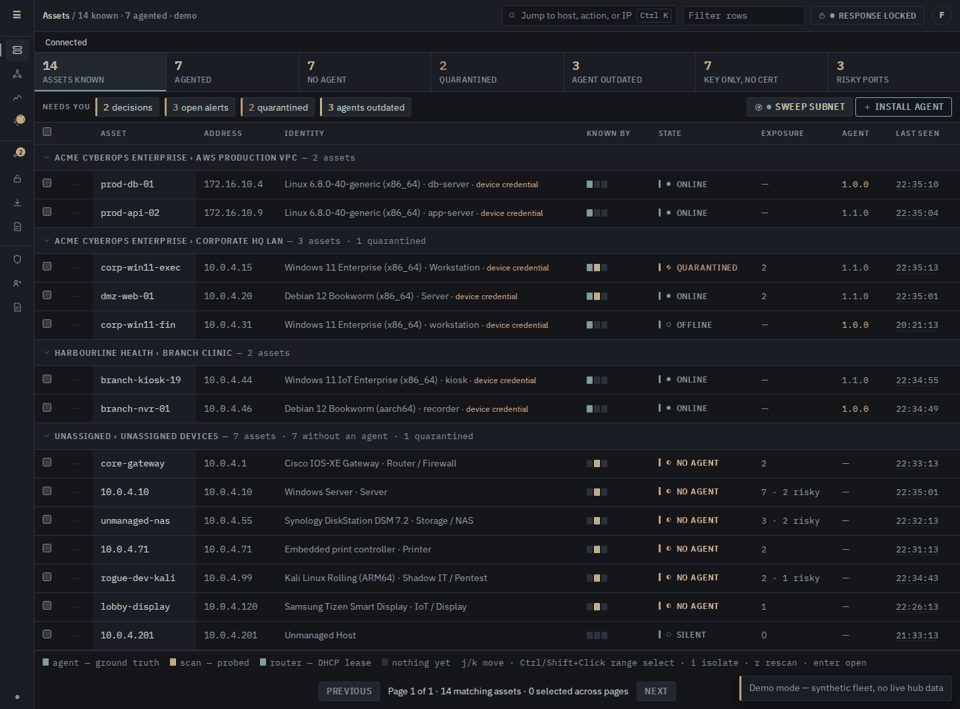
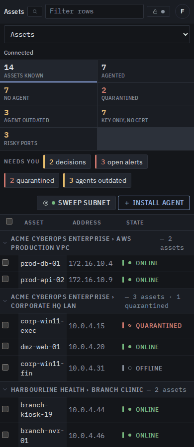

# Console UX

How the hub console is organised and why. The console should read as a place
to check and act on machines, not as documentation. Screenshots use demo mode
(`?demo=true`, synthetic fleet); the audit itself also ran against a live hub.

## Audit (before)

Captured 2026-10-17 with headless Chromium at 1440x900 and 390x844, Ash theme,
every section plus the asset view and the server-rendered pages (jobs,
timeline, evidence, status).

| Page | Words on screen | What gets in the way |
|---|---|---|
| Assets | 770 | Works well: stat tiles, grouped table, state chips. Top bar wraps to two rows on a phone. Primary actions (install, sweep) sit in the global top bar, not on the page. |
| Asset view | 1,200 | No action buttons: terminal, screen, isolate, run a package are all behind one "Actions" menu. Ten stacked cards, including three identity cards that repeat OS and role. Every package shows a full description line. Wide tables clip their last column. Demo shows "undefined matching" and "undefined open alerts". |
| Maintenance | 900 | No "run" anywhere on the page. Four monospace help paragraphs. Each package row carries a sentence; the Settings and Edit columns are clipped at desktop width. The 20-entry software catalog is always expanded and is most of the page. Linux and Windows packages with the same name look like duplicates. |
| Alerts | 890 | Action column clipped. The summary card spends three lines on a legend. Phone: table scrolls sideways inside the card. |
| Response | 460 | The script library is a full-height table with long descriptions; unlock is a plain button under a monospace paragraph. |
| Policy | 1,700 | Hundreds of threat indicators render inline (9,000 px page). Exclusion state column clipped. |
| Audit | 1,900 | Readable table; fine as a dense log. |
| Jobs page | 900 | 68 "in flight", most "taken by the agent" for days; nothing says they are stuck. One long flat list. |
| Timeline | 6,000 | Three lines per event; 26,000 px for one day. |

Patterns across pages:

1. Help text is always shown, in monospace, as a bordered paragraph (`p.pending`, 44 uses).
2. Primary actions are buried (asset menu) or missing (Maintenance has no run button).
3. Reference lists (catalog, indicators, script library, permitted services) are always expanded.
4. Descriptions sit on every row instead of on demand.
5. Wide tables clip their action column instead of fitting it.
6. Nothing collects "what needs me now": decisions live on Maintenance, alerts on Alerts, stuck jobs nowhere.

Before, desktop:

Before, phone:

## Design

Built around the owner's jobs: see fleet health at a glance; act on a machine;
run and schedule maintenance; answer decisions; review history; change
settings. The visual language (Ash/Graphite themes, mono labels, state chips,
cards, sheets) stays; it is not the problem.

### Shared patterns

- **One primary action per page**, in the page or card head, styled `btn-primary`.
- **Status as chips and counts** in card heads ("2 running · 1 stalled"), not sentences.
- **Help on demand**: a "?" button in the card head opens the one-paragraph
  explanation; at most one short line stays visible. Replaces the always-on
  `p.pending` paragraphs that explain rather than report state.
- **Reference lists start folded**: head shows the count, "Show all (N)" opens it.
- **Descriptions on demand**: rows show name and chips; the description opens with
  the row (expander) or in the existing side sheet.
- **Tables fit**: action columns never clip; on a phone rows stack (`stackOnPhone`).
- **Needs you**: one strip that collects decisions, needs-hands or stalled runs,
  high alerts and outdated agents, each a link to where it is answered.

### Navigation

Rail groups follow the jobs: **Fleet** (Assets, Topology, Traffic, Alerts),
**Act** (Maintenance, Response, Forensics, Timeline), **Settings** (Policy,
Access, Audit). Maintenance gets a badge for open decisions and runs that need
hands. Install agent and subnet sweep move from the global top bar into the
Assets page head, so the phone top bar fits on one row.

### Fleet overview (Assets)

- Needs-you strip above the stat tiles, hidden when empty.
- Page head: primary **Install agent**, secondary **Sweep subnet**.
- Table, grouping, row expander unchanged.

### Asset view

- Head: name, state chip, OS/role/version chips, last seen.
- Action bar: **Terminal**, **Screen** (when capable), **Run package…**,
  **Maintenance mode**, **Isolate** (danger style), **More** (existing menu).
- Body in tabs: **Overview** (facts grid, open alerts count, exposure, last
  maintenance results, access and lock settings), **Maintenance** (packages,
  windows), **Network** (if isolated, talks to, recent flows), **Software**,
  **Evidence** (identity claims and how it was identified).
- Fix the "undefined" counts.

### Maintenance

- Head chips: schedule on/off, window, running, decisions. Primary **Run…**
  (package or playbook on chosen machines); secondary **New playbook**.
- Order: Needs you (decisions, needs-hands runs) → Running and recent runs →
  Playbooks → Packages (compact rows, description on demand, Linux/Windows chip
  always shown) → Software catalog (folded, count in head).
- Window editor and fleet toggle go into a compact settings row with "?" help.

### Jobs and history

- Response page: **Unlock** primary in the head; script library rows compact with
  descriptions on demand.
- Jobs page: state filter chips; runs offered or taken but silent for over an
  hour show a "stuck?" chip.
- Timeline: one line per event (time, kind, title, host); detail on expand.

### Decisions

Decisions stay where they are answered (Maintenance, Alerts); the needs-you
strip and the rail badge make them visible from anywhere. Owner approvals still
arrive on the phone; the console shows "waiting for your phone" chips.

### Settings

- Policy: detection tuning as on/off chips; threat indicators folded with count
  and search; exclusion state never clipped.
- Access and Audit unchanged apart from shared patterns.

## Order of work

Shared patterns and Assets first, then Alerts, Response and jobs, then Policy.
Asset view and Maintenance come last, after the supervised-runs work lands
there, so its run states, windows, steward and lock-level blocks fit the new
layout rather than the old one.

## After

Filled in as each page lands. Each page was checked at 1440x900 and 390x844
in demo mode, with the fixture browser suite and the axe responsive check.

### Shared patterns and Assets

- `card(title, body, actions, wide, help)` takes an optional help paragraph,
  shown behind a "?" in the card head; `foldRows` folds reference lists;
  `needsYouItems()` / `needsYouBar()` collect what waits on the owner;
  `pageTools(left, actions)` lays out a page head.
- Assets: needs-you strip (decisions, open alerts, quarantined, outdated
  agents; each a link) and the page's own actions, **Install agent** (primary)
  and **Sweep subnet**. Both left the global top bar and are in the command
  palette.
- Rail regrouped Fleet / Act / Settings; Maintenance shows a badge with open
  decisions, read in the background once a minute.
- Phone top bar fits one row (lock state as icon and dot, search as icon).
- Asset view no longer prints "undefined" for host alert and flow counts; demo
  host reads answer for that host only.

### Alerts and Response

- Alerts: "Busiest hosts" with a one-line scope ("3 open alerts on 2 hosts")
  and the colour legend behind "?". Filters read Open only / All / Critical...;
  "Clear acknowledged" is now "Delete acknowledged…" because it deletes. The
  table has one Finding column (title, then type and technique) that wraps, so
  Acknowledge and Expected are always visible; with a finding open beside the
  table, destination and process move to the detail panel. On a phone each
  alert is a compact block led by its finding.
- Response: one bar replaces three cards: lock state, terminals running and
  jobs in flight (links), then Open a terminal, Job history and **Unlock**
  (primary) or Session details and Lock. The access explanation is behind "?".
  Script library rows carry the description under the name, fold after 8, and
  explain versions and retire behind "?"; scheduled scripts get plain column
  names.

