# Console UX

How the hub console is organised and why. The console should read as a place
to check and act on machines, not as documentation. Screenshots use demo mode
(`?demo=true`, synthetic fleet); the audit itself also ran against a live hub.

## Audit (before)

Captured 2026-10-17 with headless Chromium at 1440x900 and 390x844, Ash theme,
every section plus the asset view and the server-rendered pages (jobs,
timeline, evidence, status).

| Page | Words on screen | What gets in the way |
|---|---|---|
| Assets | 770 | Works well: stat tiles, grouped table, state chips. Top bar wraps to two rows on a phone. Primary actions (install, sweep) sit in the global top bar, not on the page. |
| Asset view | 1,200 | No action buttons: terminal, screen, isolate, run a package are all behind one "Actions" menu. Ten stacked cards, including three identity cards that repeat OS and role. Every package shows a full description line. Wide tables clip their last column. Demo shows "undefined matching" and "undefined open alerts". |
| Maintenance | 900 | No "run" anywhere on the page. Four monospace help paragraphs. Each package row carries a sentence; the Settings and Edit columns are clipped at desktop width. The 20-entry software catalog is always expanded and is most of the page. Linux and Windows packages with the same name look like duplicates. |
| Alerts | 890 | Action column clipped. The summary card spends three lines on a legend. Phone: table scrolls sideways inside the card. |
| Response | 460 | The script library is a full-height table with long descriptions; unlock is a plain button under a monospace paragraph. |
| Policy | 1,700 | Hundreds of threat indicators render inline (9,000 px page). Exclusion state column clipped. |
| Audit | 1,900 | Readable table; fine as a dense log. |
| Jobs page | 900 | 68 "in flight", most "taken by the agent" for days; nothing says they are stuck. One long flat list. |
| Timeline | 6,000 | Three lines per event; 26,000 px for one day. |

Patterns across pages:

1. Help text is always shown, in monospace, as a bordered paragraph (`p.pending`, 44 uses).
2. Primary actions are buried (asset menu) or missing (Maintenance has no run button).
3. Reference lists (catalog, indicators, script library, permitted services) are always expanded.
4. Descriptions sit on every row instead of on demand.
5. Wide tables clip their action column instead of fitting it.
6. Nothing collects "what needs me now": decisions live on Maintenance, alerts on Alerts, stuck jobs nowhere.

Before, desktop:

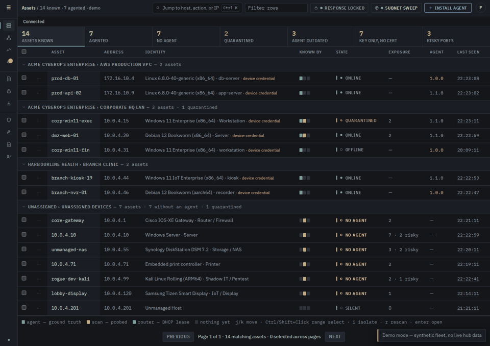
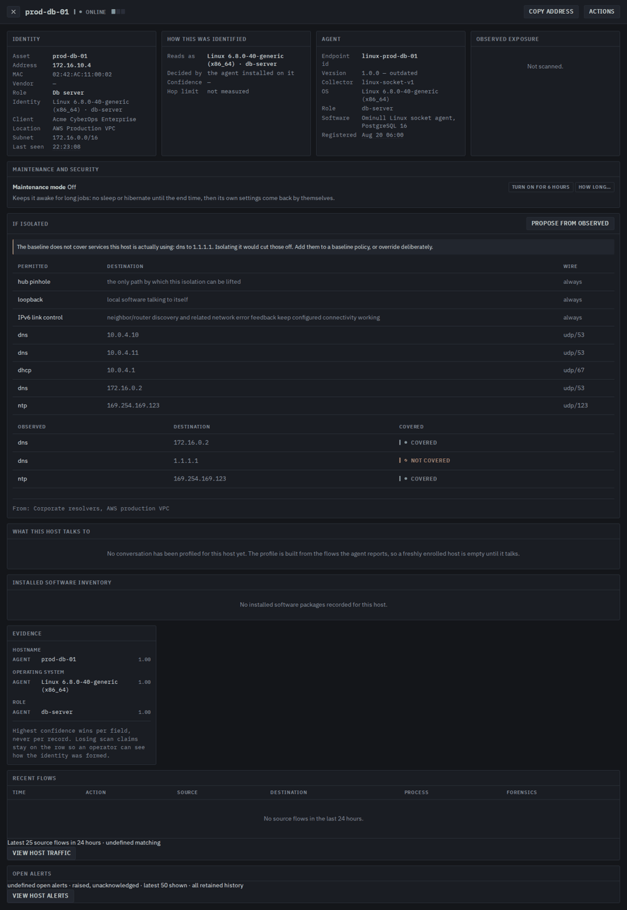
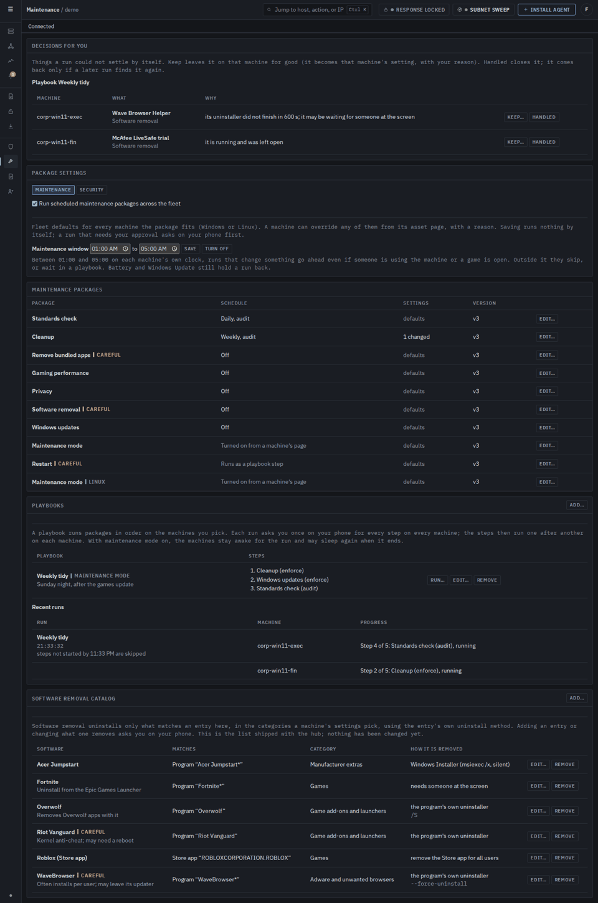
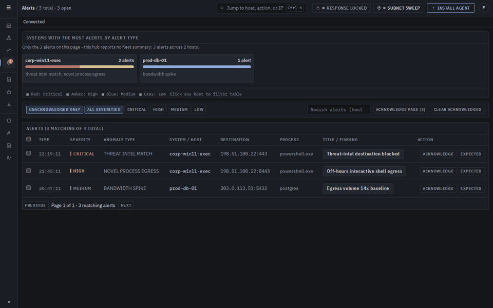
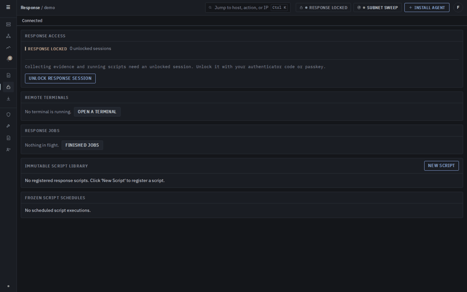
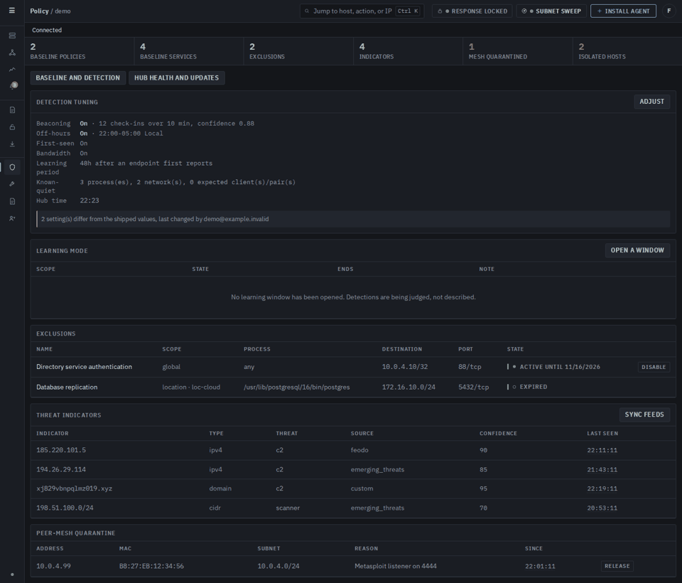

Before, phone:

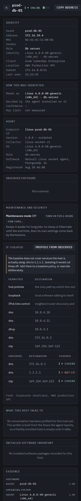
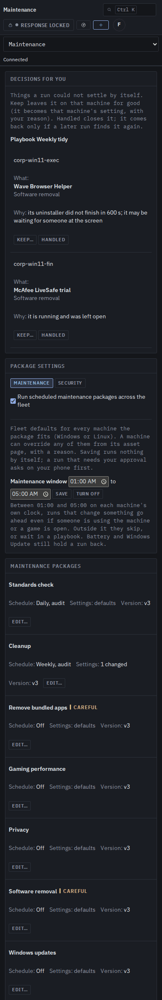

## Design

Built around the owner's jobs: see fleet health at a glance; act on a machine;
run and schedule maintenance; answer decisions; review history; change
settings. The visual language (Ash/Graphite themes, mono labels, state chips,
cards, sheets) stays; it is not the problem.

### Shared patterns

- **One primary action per page**, in the page or card head, styled `btn-primary`.
- **Status as chips and counts** in card heads ("2 running · 1 stalled"), not sentences.
- **Help on demand**: a "?" button in the card head opens the one-paragraph
  explanation; at most one short line stays visible. Replaces the always-on
  `p.pending` paragraphs that explain rather than report state.
- **Reference lists start folded**: head shows the count, "Show all (N)" opens it.
- **Descriptions on demand**: rows show name and chips; the description opens with
  the row (expander) or in the existing side sheet.
- **Tables fit**: action columns never clip; on a phone rows stack (`stackOnPhone`).
- **Needs you**: one strip that collects decisions, needs-hands or stalled runs,
  high alerts and outdated agents, each a link to where it is answered.

### Navigation

Rail groups follow the jobs: **Fleet** (Assets, Topology, Traffic, Alerts),
**Act** (Maintenance, Response, Forensics, Timeline), **Settings** (Policy,
Access, Audit). Maintenance gets a badge for open decisions and runs that need
hands. Install agent and subnet sweep move from the global top bar into the
Assets page head, so the phone top bar fits on one row.

### Fleet overview (Assets)

- Needs-you strip above the stat tiles, hidden when empty.
- Page head: primary **Install agent**, secondary **Sweep subnet**.
- Table, grouping, row expander unchanged.

### Asset view

- Head: name, state chip, OS/role/version chips, last seen.
- Action bar: **Terminal**, **Screen** (when capable), **Run package…**,
  **Maintenance mode**, **Isolate** (danger style), **More** (existing menu).
- Body in tabs: **Overview** (facts grid, open alerts count, exposure, last
  maintenance results, access and lock settings), **Maintenance** (packages,
  windows), **Network** (if isolated, talks to, recent flows), **Software**,
  **Evidence** (identity claims and how it was identified).
- Fix the "undefined" counts.

### Maintenance

- Head chips: schedule on/off, window, running, decisions. Primary **Run…**
  (package or playbook on chosen machines); secondary **New playbook**.
- Order: Needs you (decisions, needs-hands runs) → Running and recent runs →
  Playbooks → Packages (compact rows, description on demand, Linux/Windows chip
  always shown) → Software catalog (folded, count in head).
- Window editor and fleet toggle go into a compact settings row with "?" help.

### Jobs and history

- Response page: **Unlock** primary in the head; script library rows compact with
  descriptions on demand.
- Jobs page: state filter chips built from the hub's own state labels. No
  generic "stuck?" rule: the hub labels stalled and waiting runs itself, and
  terminal and screen jobs that never closed are closed at the source.
- Timeline: one line per event (time, kind, title, host); detail on expand.

### Decisions

Decisions stay where they are answered (Maintenance, Alerts); the needs-you
strip and the rail badge make them visible from anywhere. Owner approvals still
arrive on the phone; the console shows "waiting for your phone" chips.

### Settings

- Policy: detection tuning as on/off chips; threat indicators folded with count
  and search; exclusion state never clipped.
- Access and Audit unchanged apart from shared patterns.

## Order of work

Shared patterns and Assets first, then Alerts, Response and jobs, then Policy.
Asset view and Maintenance come last, after the supervised-runs work lands
there, so its run states, windows, steward and lock-level blocks fit the new
layout rather than the old one.

## After

Filled in as each page lands. Each page was checked at 1440x900 and 390x844
in demo mode, with the fixture browser suite and the axe responsive check.

### Shared patterns and Assets

- `card(title, body, actions, wide, help)` takes an optional help paragraph,
  shown behind a "?" in the card head; `foldRows` folds reference lists;
  `needsYouItems()` / `needsYouBar()` collect what waits on the owner;
  `pageTools(left, actions)` lays out a page head.
- Assets (second pass, rebuilt): the stat tiles and their sparkline history
  are gone. A filter bar replaces them, and each chip is the filter and its
  count: scope (All, With agent, No agent), then problems (Offline,
  Quarantined, Agent outdated, Risky ports, No client cert). The agent scopes
  are exclusive; **Clear filters** and "N of M shown" sit at the end. The
  needs-you strip keeps only what is not a filter (decisions, open alerts);
  it no longer repeats quarantined and outdated.
- Six columns you scan by: **Asset** (name, evidence bars, terminal glyph,
  and a short "what it is" line; the full identity is the tooltip), Address,
  State, **Agent** (version, "outdated", or **Install...** when there is
  none), **Exposure** ("3 ports", "2 risky") and Last seen. All six sort,
  inside each client and location group. Groups read in plain sentence case
  with counts; unassigned machines come last as "Not assigned to a location".
- Click a row for a quick look: About (address, MAC, role with how sure,
  risk, client, agent), Exposure (ports, weak points), and Actions (**Open
  full view**, Isolate or Release, Install agent, Rescan, and a link to how
  the identity was formed). The merged-claims and "why we think this" columns
  moved to the asset view, where Facts now also carries risk and the reason
  for the role.
- Phone: no table. Each machine is a card (name, state, address, last seen,
  agent, exposure) with 44px targets; the filter chips scroll sideways on one
  line.
- The pager only appears past 100 matches. The page help is behind "?".
- Install agent and Sweep subnet left the global top bar and are in the
  command palette.
- Rail regrouped Fleet / Act / Settings; Maintenance shows a badge with open
  decisions, read in the background once a minute.
- Phone top bar fits one row (lock state as icon and dot, search as icon).
- Asset view no longer prints "undefined" for host alert and flow counts; demo
  host reads answer for that host only.

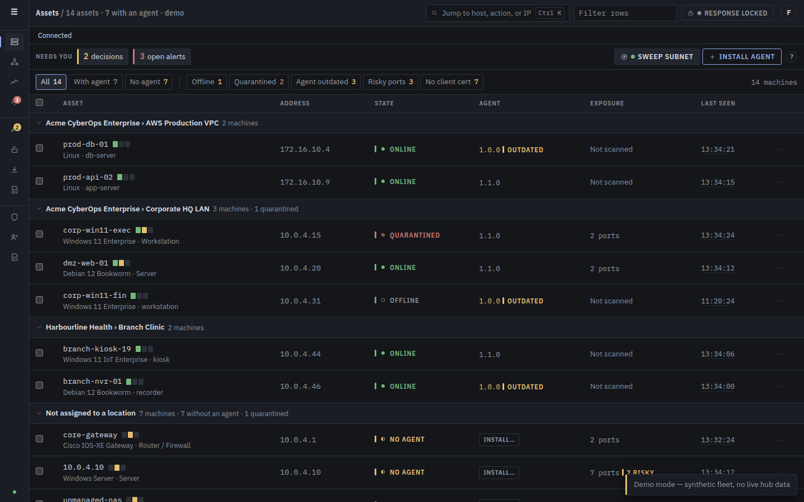
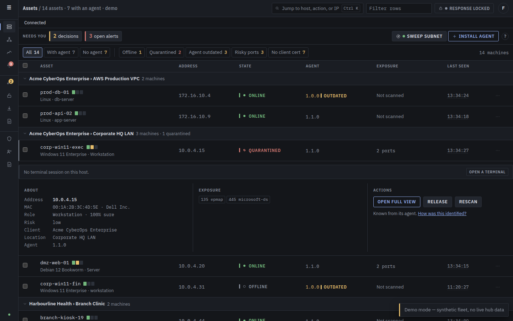
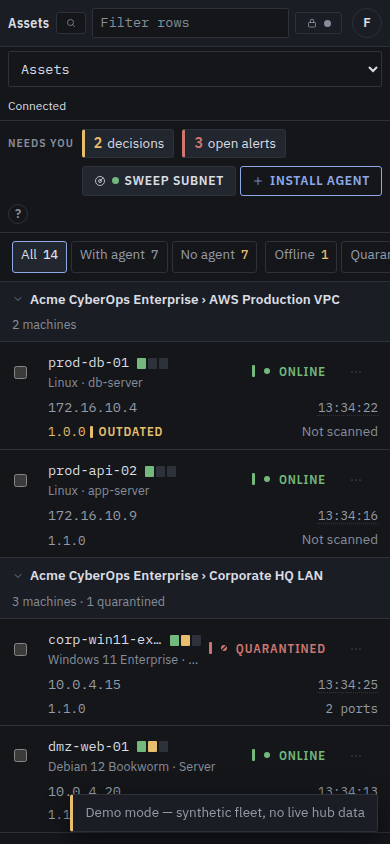

### Alerts and Response

- Alerts: "Busiest hosts" with a one-line scope ("3 open alerts on 2 hosts")
  and the colour legend behind "?". Filters read Open only / All / Critical...;
  "Clear acknowledged" is now "Delete acknowledged…" because it deletes. The
  table has one Finding column (title, then type and technique) that wraps, so
  Acknowledge and Expected are always visible; with a finding open beside the
  table, destination and process move to the detail panel. On a phone each
  alert is a compact block led by its finding.
- Response: one bar replaces three cards: lock state, terminals running and
  jobs in flight (links), then Open a terminal, Job history and **Unlock**
  (primary) or Session details and Lock. The access explanation is behind "?".
  Script library rows carry the description under the name, fold after 8, and
  explain versions and retire behind "?"; scheduled scripts get plain column
  names.

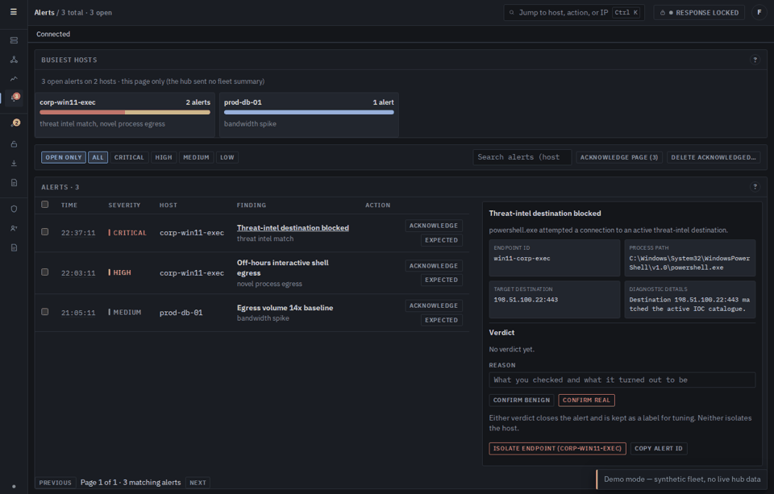
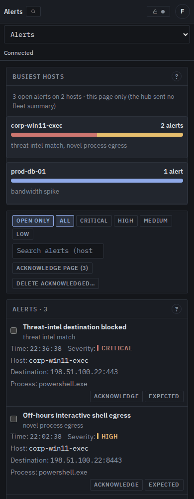
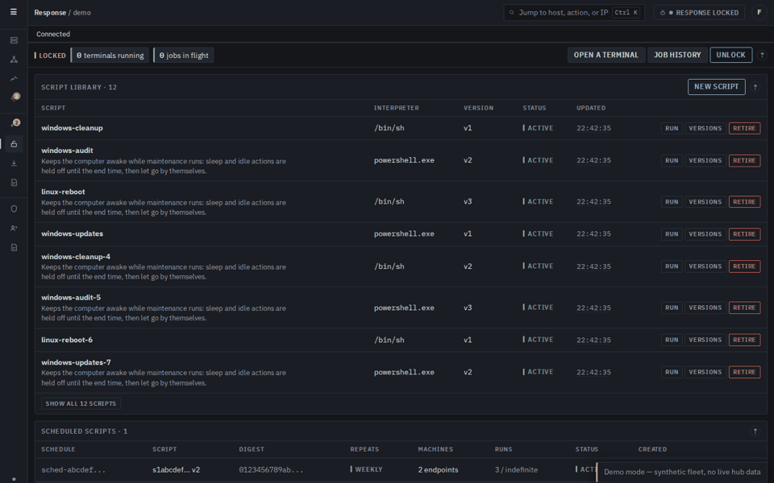

### Settings (Policy, Access, Audit)

- Policy: two views, **Detection** (isolation baseline, tuning, learning mode,
  exclusions, threat indicators, peer-mesh quarantine) and **Hub health**
  (diagnostics, release convergence). Detection tuning is a row of on/off
  chips with one line per detector and a head chip for how many values differ
  from what shipped. Threat indicators fold after 10 with the count in the
  head. Every card's explanation is behind "?"; exclusion state and long
  process paths wrap instead of clipping. On a phone each policy row is a
  compact block.
- Access: the Cloudflare Access explanation moved behind "?"; the one-line
  description of the chosen role stays under the form.
- Audit: actions read as words ("Isolate host") with the raw code on hover,
  and the action filter accepts either form. **Filter history** is the page's
  primary action.

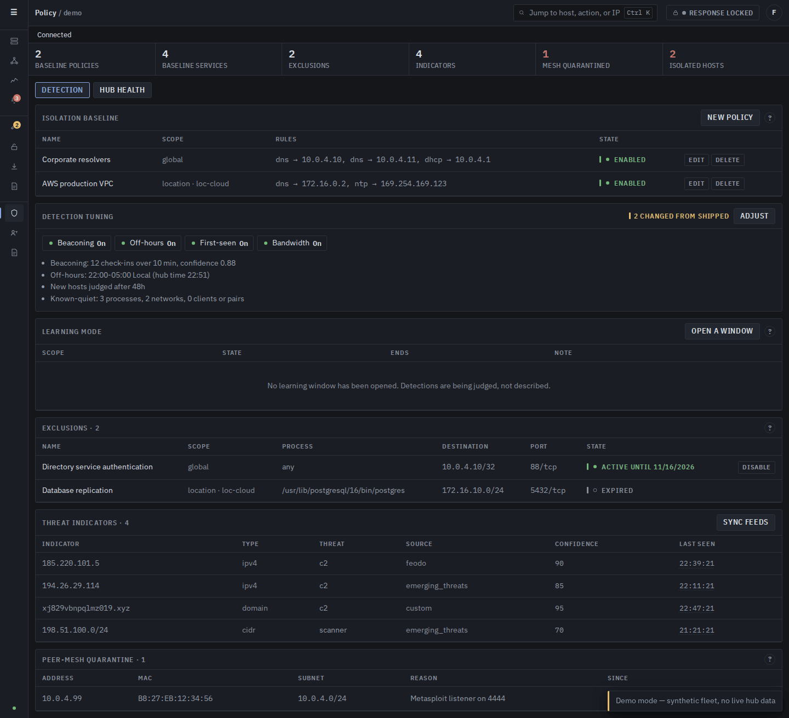
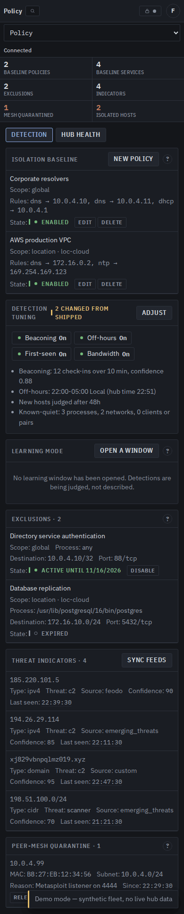
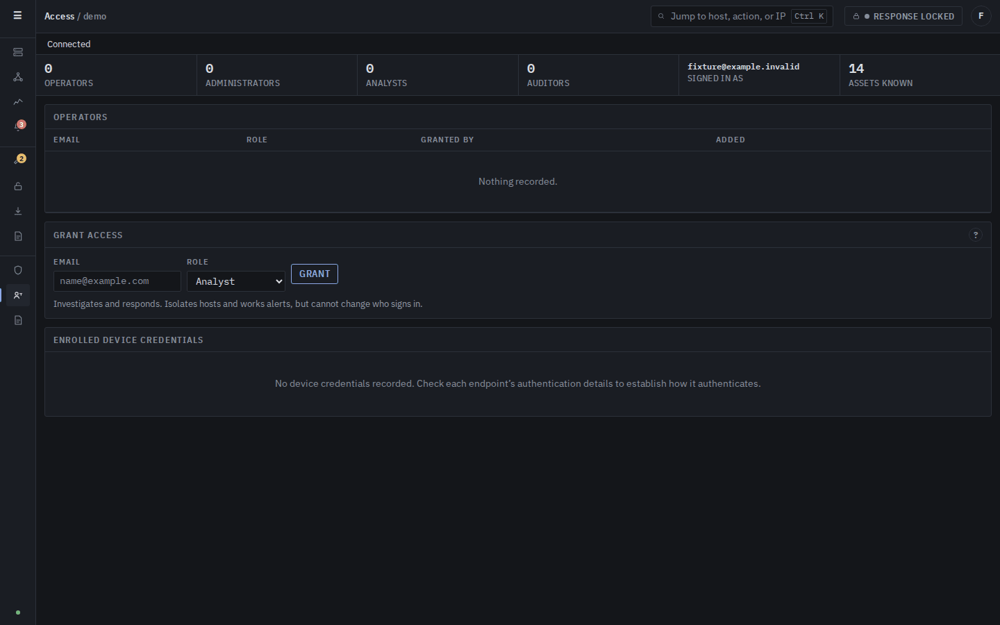
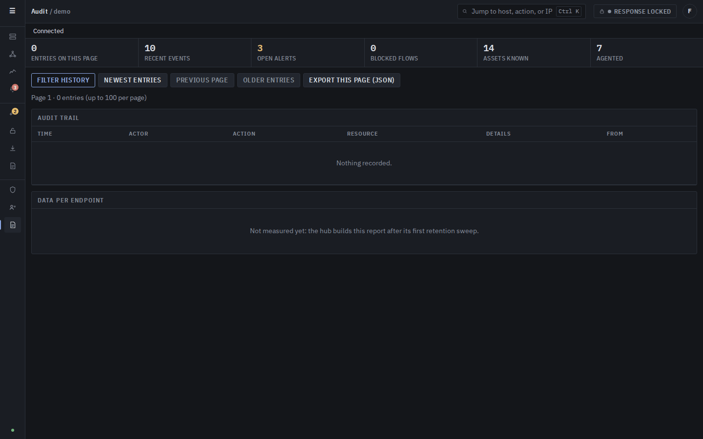

### Timeline

- One line per event: time, kind, title, then host and who on the same line.
  The detail opens with the line (a native disclosure, so it works without a
  script and from the keyboard).
- The same event repeated in a row (same kind, title, host and actor) shares
  one line with a count ("×6") and opens to the time span and each distinct
  detail. The page line says when repeats were folded.
- A **What** filter keeps one kind (Finding, Hunt lead, Containment,
  Approval, Sign-in...), with each kind's count; repeats of that kind fold
  even when other kinds sat between them.

Rendered from synthetic events (22 events on 14 lines):

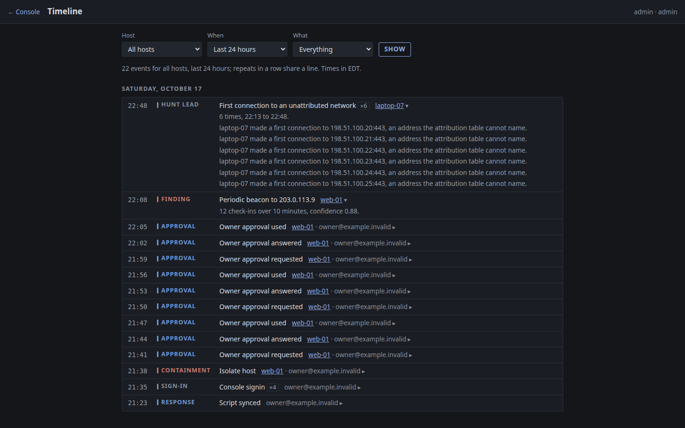
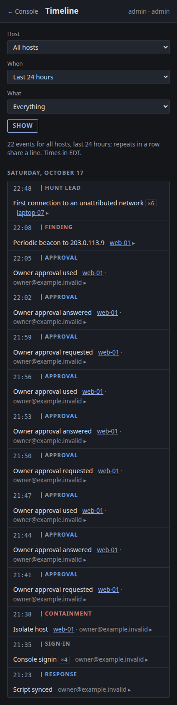

### Jobs

- Above the list, one chip per state in the current tab (In flight or
  Finished) with its count, using the hub's own labels (Running, Stalled,
  Taken by the agent...). A chip narrows the list to that state; All shows
  everything again. The labels come from the hub, so the page never invents a
  state.
- Each job is one line (action, host, state, when, who); the action is the
  link to the job, so the separate Details button is gone.

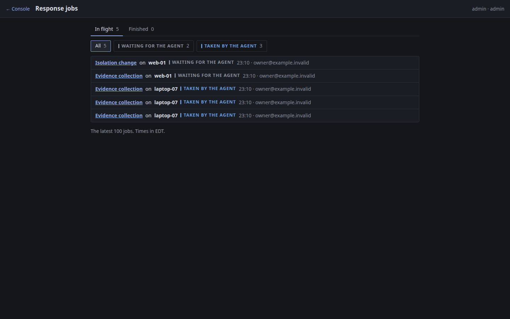
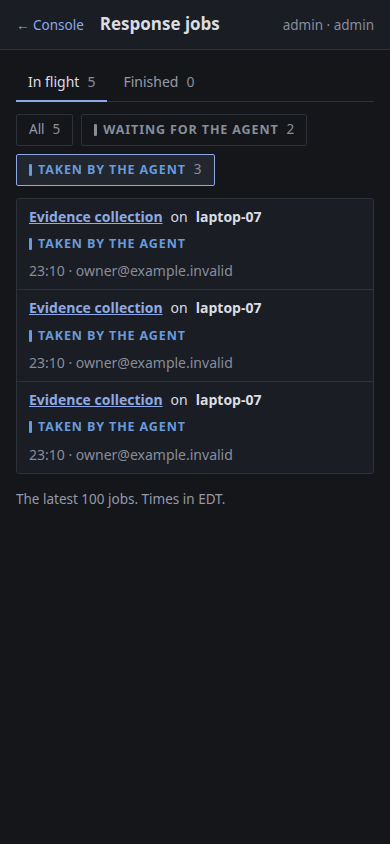

### Maintenance

- Page head: Maintenance / Security tabs, then chips for schedule on or off,
  the window ("Window 01:00–05:00" or "No window") and open decisions.
  **Run…** (primary) opens one sheet: pick a package, a mode and the machines
  it fits (the list follows the package's Linux or Windows platform); one
  approval covers the run. **New playbook** sits beside it.
- Order: Decisions for you → Playbook runs (shown when there is one, with a
  "1 running" chip) → Playbooks → Packages → Schedule → Software removal
  catalog. Each card's explanation is behind "?".
- Package rows show name, a Linux or Windows chip on every row (the two
  "Maintenance mode" packages no longer look like duplicates) and careful;
  the description opens from the name. Each runnable package has its own
  **Run…** next to Edit.
- Schedule is one compact row: the fleet toggle and the window.
- The software removal catalog folds after 3 entries with its size in the
  head ("6 · as shipped").
- Demo mode now carries package descriptions so the page reads as it does on
  a hub.

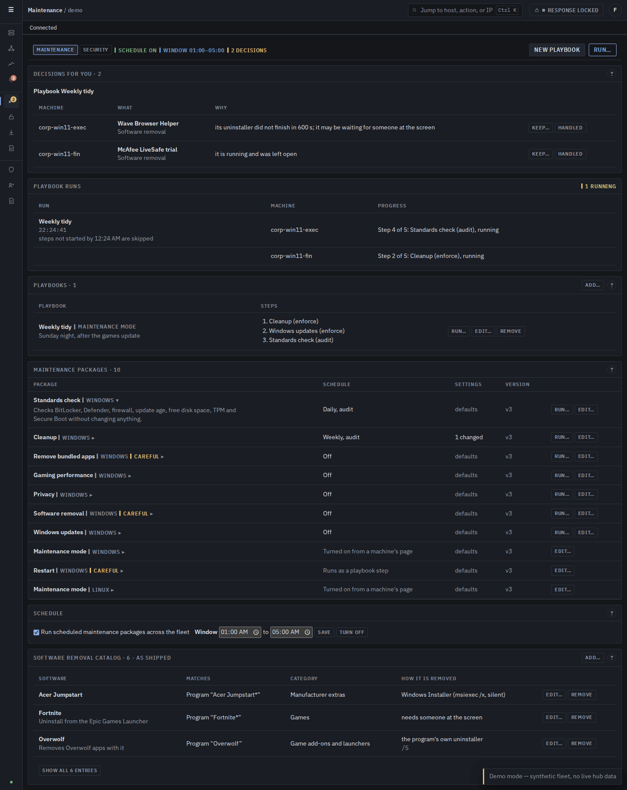
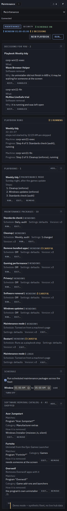
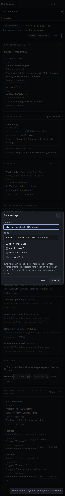

### Run states (supervised runs)

- A run the agent supervises can be **Stalled** (no output, CPU or disk
  activity for a while, or no word from the machine) or **Waiting on a
  window** (a visible window wants a click). Both used to fall back to
  "Failed" in the console. They are red state chips now, next to **Not run**
  (offline past the window).
- Under the chip, one live line: progress ("62% Installing update 3 of 5"),
  the window it waits on (title and program), the reason, and "last word 20s
  ago". It shows in the machine's Maintenance card and in Playbook runs.
- A stuck run counts in the needs-you strip ("1 run waiting on a window", "1
  run stalled"), in the Maintenance rail badge (with the open decisions), and
  as a red "stuck" chip on Playbook runs. The console reads playbook runs in
  the background once a minute for this; runs started one at a time are
  counted when that machine's Maintenance card has been opened. The Jobs
  page lists every in-flight run.

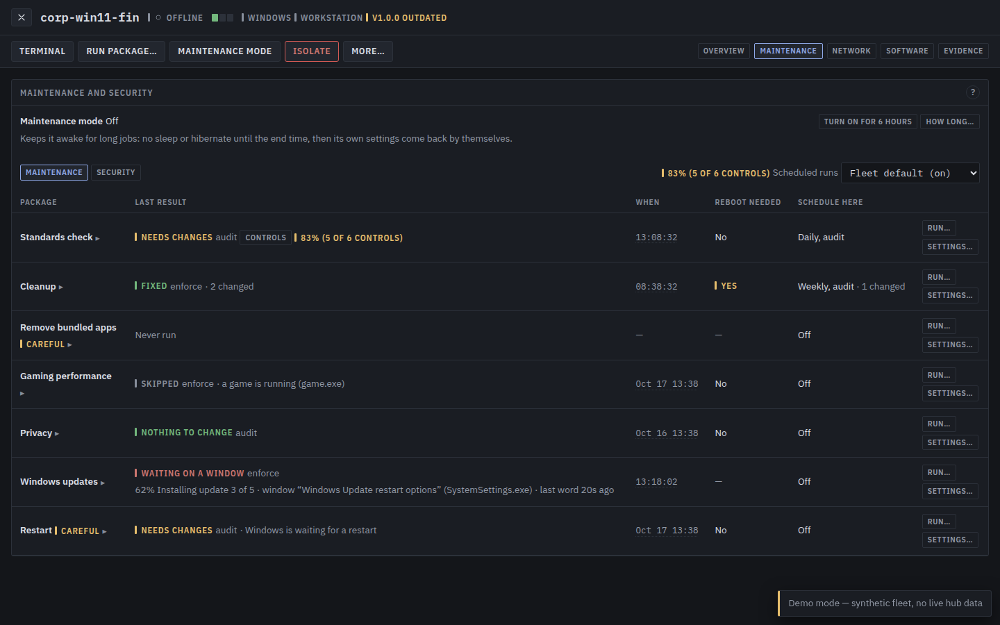
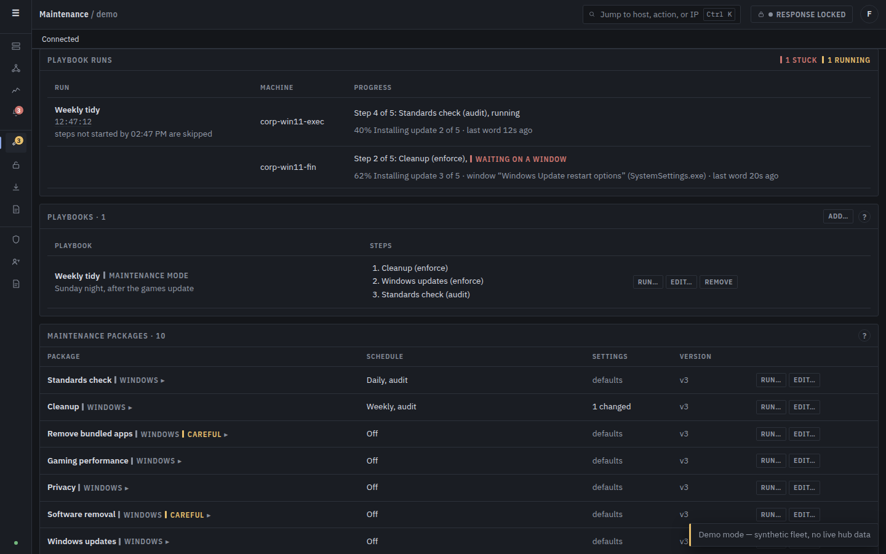
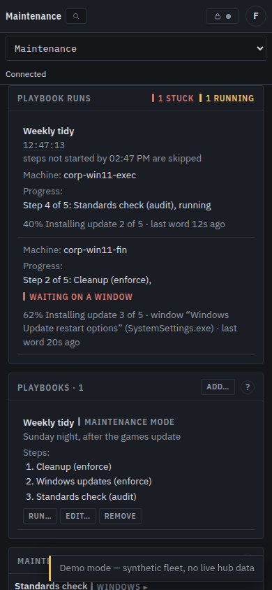

### Maintenance windows

- A machine's Maintenance card has a **Window** line under maintenance mode
  (also on a Linux host that only has maintenance mode): the ranges
  ("12:00-13:30, 22:00-02:00"), where they come from (this machine's own
  window, the fleet window, or the standard window nobody changed), and
  whether it is **Open now** or "Opens in 4 hours 15 minutes". A machine that
  has not reported its clock (and a window on its own clock) says "Machine
  clock not reported yet" instead of guessing.
- **Change...** opens a sheet: one to four from/to time rows (a range may
  cross midnight; the row says "ends the next day"), Add a range, Remove, and
  a clock choice (the machine's own clock, or UTC). **Use fleet window**
  drops a machine's own window. The Maintenance page's Schedule card shows the
  fleet window with the same sheet, **Back to 01:00-05:00**, and names the
  machines that have their own window. Setting a window runs nothing.
- The old single from/to fields and "Turn off" are gone (there is always a
  window). Uses `GET/PUT /api/v1/maintenance/windows` (admin to change);
  the demo console answers it too, with a two-range override on one host.

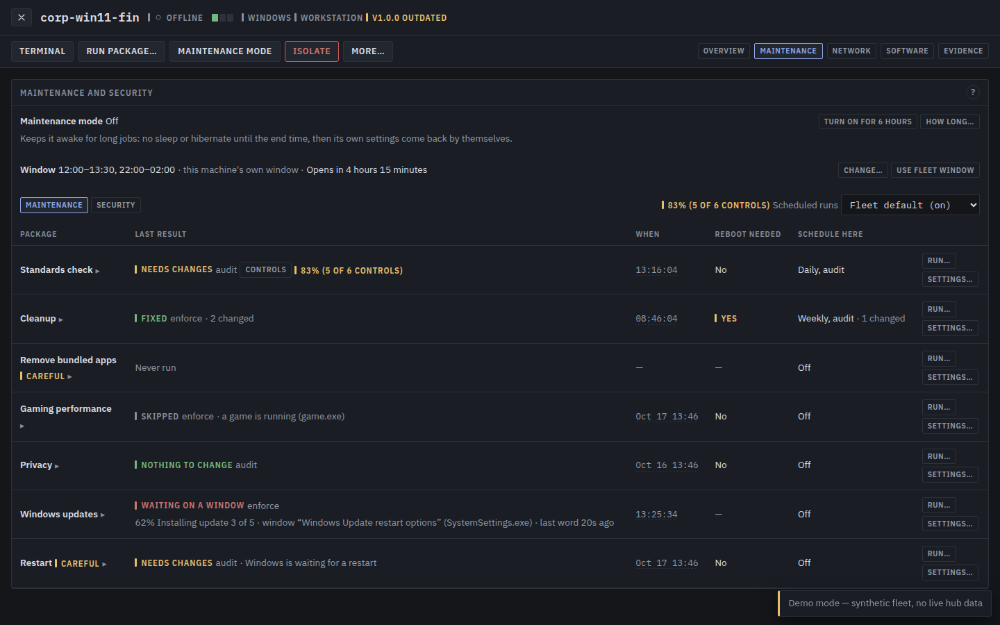
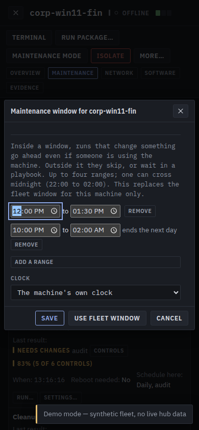
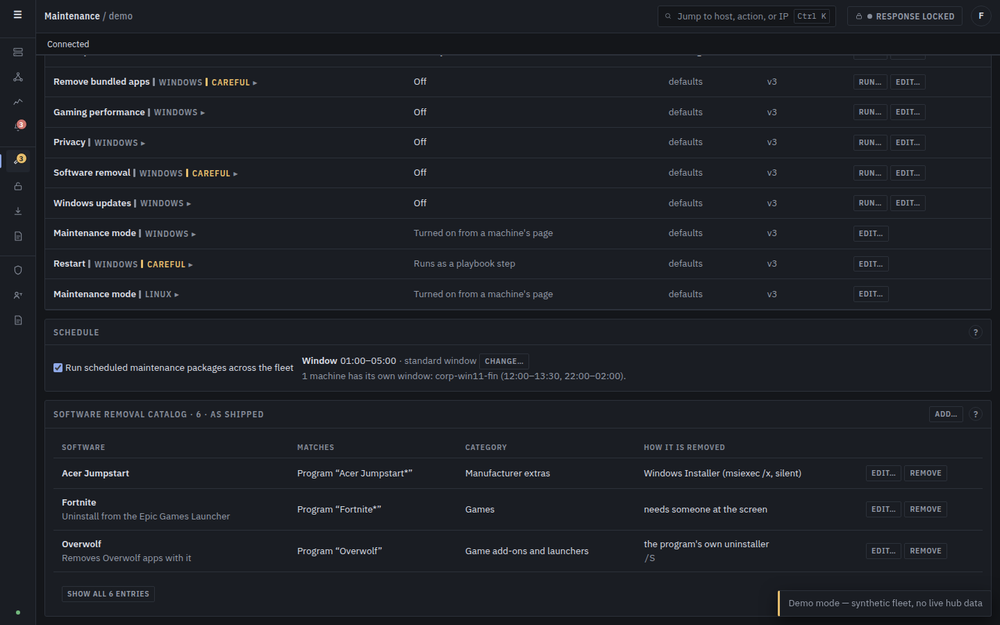
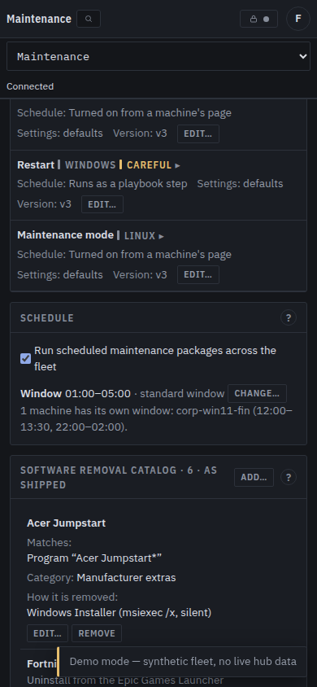

### Asset view

- Head: name, state, evidence strip, and chips for OS, role and agent version
  ("v1.0.0 outdated" in amber).
- Action bar under the head: **Terminal** (or **Reattach terminal** when one
  is open), **Screen** when the agent can share it, **Run package…** (opens
  the Maintenance tab), **Maintenance mode** / **End maintenance mode**,
  **Isolate** (red) or **Release**, and **More…** for the full menu. An
  unmanaged asset gets **Install agent**, **Rescan** and More….
- Tabs: **Overview** (one Facts card that merges identity and agent, open
  alerts with the count in the head, observed exposure), **Maintenance**,
  **Network** (if isolated, who it talks to, recent flows), **Software**,
  **Evidence** (how the identity was formed). Tabs with nothing to show are
  left out. The tab resets to Overview when another asset opens.
- Package descriptions open from the name; the mode explanation is behind "?".
- The open-alert line says "Latest 50 of N shown" only when there are more
  than shown.

For features that add a block to a machine (windows, steward, lock level),
the tab list in `renderRoute` is the place: each tab is a list of cards.

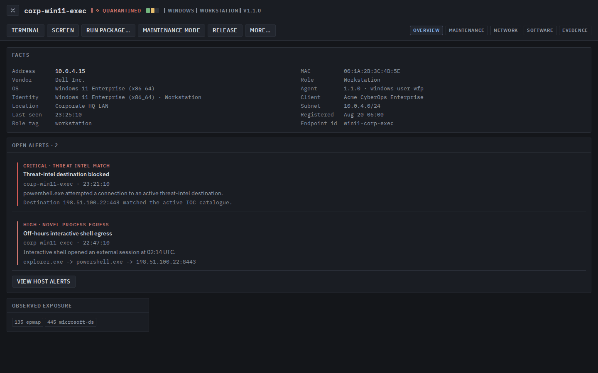
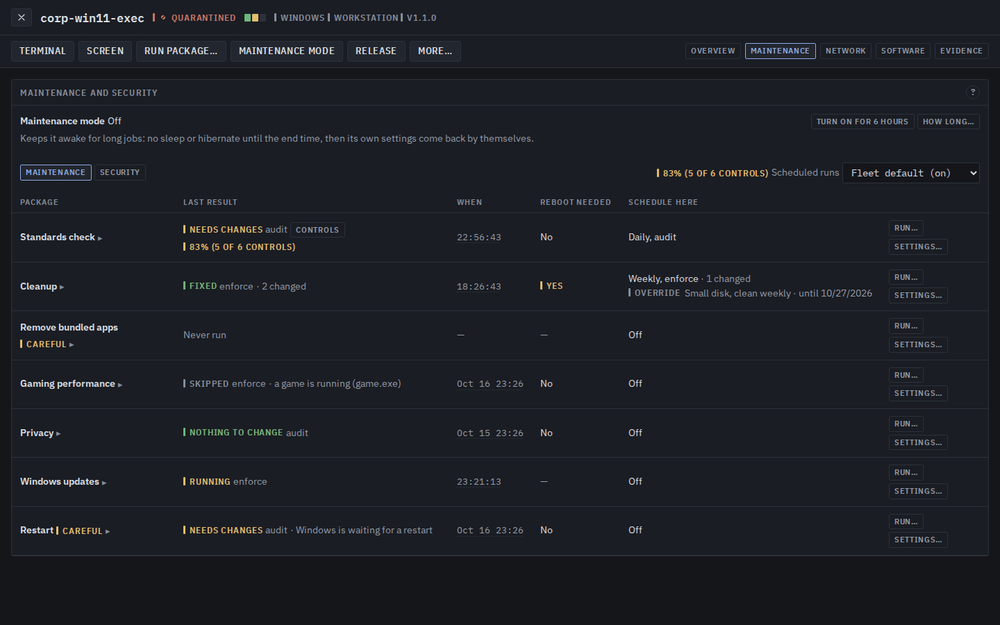
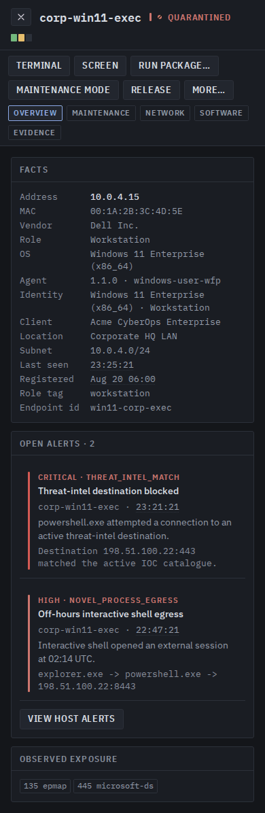
